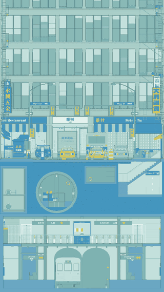

# StreetAnatomy

English · [中文](README.zh-CN.md)

<p align="center"></p>

StreetAnatomy is a one-point perspective drawing that moves: a long street in Manhattan's Chinatown, with the sewers and the subway station beneath it. Drag the vanishing point and the whole drawing re-draws its perspective, the way it would on paper; turn depth down to 0 and it folds back into a flat elevation.

Inspired by [@garments__](https://x.com/garments__) on X.

## How it works

### Not 3D: a perspective drawing

There is no camera, field of view or view frustum. Every point is first placed on the page as in an elevation drawing (x to the right, y up), then pulled toward the vanishing point according to how far behind the picture plane it is (z):

```text
w = 1 + k × depth × z
P = VP + (elevation position(x, y) − VP) / w
```

- Points at z = 0 don't move, so the front layer of the picture (the cut section) is always an undistorted elevation.
- The farther a point is, the larger w and the closer it moves to the vanishing point VP, so every line running into depth meets at VP. This is exactly how one-point perspective is drawn by hand.
- **Depth** multiplies k: at 0 every point stays where the elevation puts it and the picture is a flat elevation; at 1 it is ordinary perspective; above 1 depth is exaggerated.
- The **vanishing point** can go anywhere on the page. Dragging it redraws the perspective of the whole scene; nothing "turns a camera".

### The cut section: seeing above and below ground at once

The front of the picture is a section cut at z = 0: the road, soil, pipes and the station's walls and floors are sliced open there, and the cut faces are solid. The street, the sewer and the station are spaces that run back from the cut, seen through their own openings.

This gives a simple rule: **a layer can only be seen clearly when the vanishing point is within its own height range**. Everything with depth shrinks toward the vanishing point, so when the vanishing point is above ground the spaces underground shrink behind the solid soil, and when it is at platform height the street shrinks away instead. That is why every viewpoint in the demo sits inside the layer it shows.

### Line drawing and colour

The same geometry is drawn in two ways:

- **Line drawing**: only outlines and structural lines, in four weights by importance; the finer lines fade out sooner with distance, so far detail never clots into a smudge.
- **Colour**: every surface has a colour and a procedural material (brick joints, stone, glass reflections, lighting), with no texture images.

You can switch between them at any time (`L`); in the demo the drawing turns from line to colour as depth unfolds. The guides (`G`) draw the real depth lines, showing that they all meet at one point.

## Opening it

Open `index.html` in a browser with WebGL2 (such as Chrome or Edge). There is nothing to install or build. The demo starts playing on its own.

| Control | What it does |
| --- | --- |
| Drag | Move the vanishing point |
| Depth slider (纵深) | 0 is the flat elevation, 1 is ordinary perspective, up to 1.6 |
| Scroll / double-click | Zoom / reset |
| Preset buttons | Flat elevation, centre, left, right, high, low, sewer, fare level, platform |
| Space | Play or pause the demo |
| `L` / `G` | Switch between line drawing and colour / guides |
| `H` or "clean view" (净画面) | Hide the interface for screen recording; `Esc` or double-click to bring it back |
| `0` | Return to the starting viewpoint |

The on-screen labels are in Chinese.

## Files

| File | Contents |
| --- | --- |
| `src/engine.js` | The projection above, WebGL2 drawing, materials, lighting and framing |
| `src/kit.js` | Geometry construction and palette |
| `src/scene.js` | Scene assembly |
| `src/facade.js`, `src/signs.js`, `src/type.js`, `src/chinatown.js` | Building fronts, signs, lettering and street pieces |
| `src/street.js`, `src/vehicles.js` | Road, the cut section, street furniture and vehicles |
| `src/sewer.js`, `src/station.js` | Sewers, service galleries and the subway station |
| `src/tour.js`, `src/app.js` | Demo timeline; interaction and playback |
| `src/vendor/` | The Earcut triangulation library and font outlines |

Shop names are invented. Street names such as Mott, Pell, Bayard and Canal are real, but the buildings and shops do not follow the actual street.

## Licence

Copyright © 2026 sonianmu.

This project is free software under the [GNU General Public License v3.0](LICENSE): you may use, change and share it, and anything you distribute that builds on it must be released under the same licence, with its source code.

Third-party parts keep their own licences, given at the top of each file: `src/vendor/earcut.js` (ISC) and `src/vendor/fonts.js` (font outlines under the SIL OFL 1.1 and Apache 2.0).
