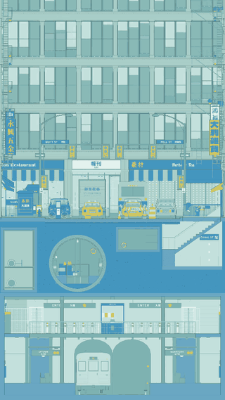

# StreetAnatomy

[English](README.md) · 中文

<p align="center"></p>

StreetAnatomy（唐人街剖面）是一张会动的单点透视图：曼哈顿唐人街的一条长街，连同它脚下的下水道和地铁站。拖动消失点，整张图像纸上的透视一样跟着变；把纵深拉到 0，它又退回一张平立面。

灵感来自 X 上的 [@garments__](https://x.com/garments__)。

## 原理

### 不是 3D，是一张透视图

这里没有相机、视角或视锥。每个点先按立面图的方式放到纸上（x 向右，y 向上），再按它离画面有多远（z），朝消失点收缩：

```text
w = 1 + k × 纵深 × z
P = VP + (立面坐标(x, y) − VP) / w
```

- z = 0 的点不动，所以画面最前面那一层（剖切面）永远是一张不变形的立面图。
- 越远的点 w 越大，越靠近消失点 VP，所有平行于纵深方向的线都汇于 VP。这正是手绘一点透视的做法。
- **纵深**乘在 k 上：为 0 时所有点都停在立面位置，画面就是平立面；为 1 时是标准透视；更大时纵深被夸张。
- **消失点**可以放在画面任何地方，拖动它时，整个场景像在纸上重新画了一遍透视，而不是“转动相机”。

### 剖面：为什么能同时看到地上和地下

画面最前面是 z = 0 的剖切面：路面、土层、管道、车站的墙和楼板在这里被“切开”，切口是实心的。街道、下水道、车站都是从切口往后延伸的空间，透过各自的开口才能看到。

这带来一个直接的规律：**一层空间只有在消失点落在它自己的高度范围内时才看得清**。所有纵深的内容都朝消失点收缩，消失点在地面以上时，地下空间会缩到实心土层后面；消失点在站台高度时，街道又会缩进去。演示里每个视角都放在要展示的那一层里，就是这个原因。

### 线稿与色稿

同一套几何有两种画法：

- **线稿**：只画轮廓和结构线，按线的重要程度分四档粗细；离得越远的细线越早淡出，所以远处不会糊成一团。
- **色稿**：每个面有颜色和程序生成的材质（砖缝、石材、玻璃反射、灯光），没有贴图。

两者可以随时切换（`L`），演示里纵深展开的同时从线稿过渡到色稿。打开辅助线（`G`）会画出真实的纵深轨迹，证明所有线都汇于同一点。

## 打开

用支持 WebGL2 的浏览器（如 Chrome、Edge）直接打开 `index.html`，不需要安装或构建。打开后自动播放演示。

| 操作 | 作用 |
| --- | --- |
| 拖动画面 | 移动消失点 |
| 「纵深」滑块 | 0 为平立面，1 为标准纵深，最大 1.6 |
| 滚轮 / 双击 | 放大 / 复位 |
| 预设按钮 | 平立面、居中、偏左、偏右、高、低、下水道、闸机层、站台 |
| 空格 | 播放或暂停演示 |
| `L` / `G` | 线稿与色稿切换 / 辅助线 |
| `H` 或「净画面」 | 隐藏界面，方便录屏；`Esc` 或双击恢复 |
| `0` | 回到初始视点 |

## 文件

| 文件 | 内容 |
| --- | --- |
| `src/engine.js` | 上面的投影公式、WebGL2 绘制、材质、光照和画面构图 |
| `src/kit.js` | 几何构造和配色 |
| `src/scene.js` | 场景组装 |
| `src/facade.js`、`src/signs.js`、`src/type.js`、`src/chinatown.js` | 建筑立面、招牌、文字和街头构件 |
| `src/street.js`、`src/vehicles.js` | 路面、剖切面、街道家具和车辆 |
| `src/sewer.js`、`src/station.js` | 下水道、管廊和地铁站 |
| `src/tour.js`、`src/app.js` | 演示时间轴，交互和播放 |
| `src/vendor/` | 三角剖分库 Earcut 和字体轮廓 |

店名是虚构的；Mott、Pell、Bayard、Canal 等街名是真实的，但建筑和商铺布局不对应实地。

## 许可

Copyright © 2026 sonianmu。

本项目以 [GNU 通用公共许可证第 3 版（GPL-3.0）](LICENSE) 发布：可以自由使用、修改和分享；在此基础上分发的作品也必须以同一许可发布，并提供源代码。

第三方部分保留各自的许可，说明写在各文件开头：`src/vendor/earcut.js`（ISC）和 `src/vendor/fonts.js`（字体轮廓，SIL OFL 1.1 与 Apache 2.0）。
